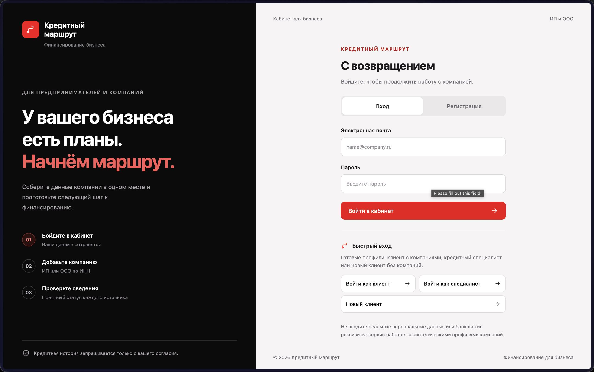
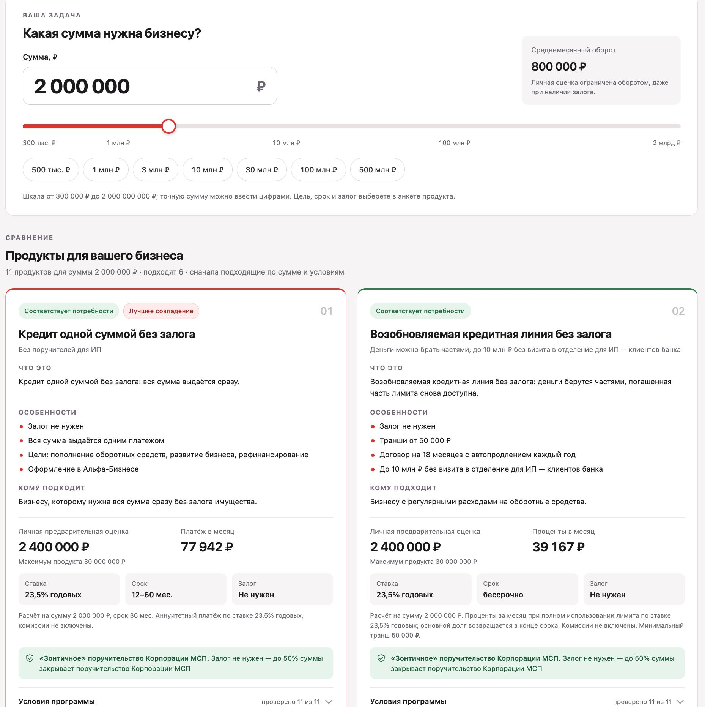

# Кредитный маршрут

Веб-приложение, которое ведёт малый бизнес (ИП и ООО) от добавления компании до окончательного решения по кредиту. Клиент указывает сумму и сравнивает на карточках с пояснениями 11 кредитных продуктов и госпрограмм, по которым кредитует Альфа-Банк. Затем он заполняет анкету из шести этапов, отправляет её с согласиями, загружает документы и после одобрения переходит в Альфа-Бизнес. Кредитный специалист разбирает заявки в очереди: видит скоринг и источники, запрашивает сведения, проверяет документы и принимает решение.

Проект сделан для Alfa Hack. Данные синтетические; реестр, обороты, БКИ, Госуслуги, уведомления и Альфа-Бизнес — локальные заглушки. Деньги не перечисляются, договор не подписывается.

| Вход | Подбор продукта |
|---|---|
|  |  |

## Быстрый старт в Docker

```sh
docker compose up --build -d        # PostgreSQL, API и интерфейс
docker compose logs --tail 20 api   # ждите строку «Uvicorn running on …»; нет её — повторите
open http://localhost:5173          # или откройте адрес в браузере
```

Открывайте именно `http://localhost:5173`: API принимает команды только с этого адреса. Запуск без Docker, сброс базы и сценарий показа описаны в [docs/demo.md](docs/demo.md).

## Учётные записи

Пароль у всех — синтетический `DemoCredit2026!`. На странице входа есть кнопки быстрого входа.

| Учётная запись | Роль |
|---|---|
| `client@demo.local` | Клиент с 10 синтетическими компаниями |
| `other@demo.local` | Клиент без компаний (кнопка «Новый клиент») |
| `officer@demo.local` | Кредитный специалист |

## Документация

| Документ | Содержание |
|---|---|
| [Запуск и показ](docs/demo.md) | Запуск локально и в Docker, учётные записи, синтетические компании, сброс, сценарий показа |
| [Архитектура](docs/architecture.md) | Компоненты, модули, конфигурация, безопасность, развёртывание, ключевые решения, ограничения |
| [Модель данных](docs/data-model.md) | ER-диаграмма, сущности, ограничения целостности, миграции, синтетические данные |
| [Состояния заявки](docs/application-states.md) | 12 статусов, переходы, BPMN, правила R1–R12, срок 14 дней, что видит клиент и что — специалист |
| [Продукты и скоринг](docs/products-and-scoring.md) | Каталог, подбор, формула лимита, факторы скоринга, правка каталога и политики |
| [OpenAPI](docs/api/openapi.yaml) · [Postman](docs/api/postman_collection.json) | Описание API и коллекция со сквозным сценарием |
| [Тестовые сценарии](docs/tests/test-scenarios.md) | Стратегия, сценарии, граничные значения, запуск тестов, результаты |
| [Продуктовое исследование](docs/research/ПродуктовоеисследованиеCustDevиJTBD.md) | CustDev, JTBD, дерево метрик, гипотезы |
| [Сторонние компоненты](THIRD_PARTY_NOTICES.md) | Библиотеки и лицензии, образы, данные, заглушки |

## Стек

React 18 + TypeScript + Vite · FastAPI + SQLAlchemy 2 + Alembic · PostgreSQL 17 · Docker Compose · pytest и Playwright.

## Структура репозитория

```
backend/    API: app/ (код), migrations/ (Alembic), tests/ (pytest)
frontend/   интерфейс: src/ (React), tests/ (Playwright)
data/       каталог продуктов, политика решений, синтетические компании
docs/       документация, описание API, изображения, журналы тестов
scoring/    исходный аналитический ноутбук скоринга
scripts/    установка, запуск API, сброс базы, выгрузка описания API
```

## Версия

Финальная версия для жюри помечена тегом `v1.0.0`.
