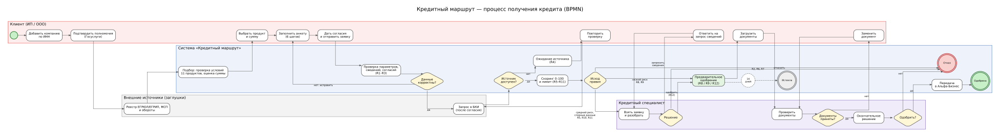

# Состояния заявки

Статус заявки меняется только через сервис переходов (`app/applications/lifecycle.py`, класс `ApplicationChange`). Произвольного «PATCH status» в API нет. Каждый переход записывает строку истории: кто, когда, почему и с какой ревизией заявки. К каждой строке прилагается уведомление в кабинете клиента. Наружу уведомления не отправляются: канал — `demo_in_app`.

## Процесс

Схема показывает четыре дорожки: клиента, системы, внешних источников (локальные заглушки) и кредитного специалиста. Путь идёт от добавления компании до окончательного решения и перехода в Альфа-Бизнес.

## 12 статусов

| Статус | Подпись в интерфейсе | Смысл |
|---|---|---|
| `DRAFT` | Черновик | Анкета создана из подбора и сохраняется по этапам, ещё не отправлена |
| `CHECKING` | Проверяется | Автоматическая проверка. Шаг виден в истории, но наступает и завершается внутри одного запроса отправки или повторной проверки, поэтому в базе заявка в этом статусе не остаётся |
| `WAIT_EXTERNAL` | Ждём источник данных | Реестр, источник оборотов или БКИ не ответили (R4) |
| `NEED_INFO` | Нужны сведения | Открыт запрос: ответов клиента (`client_answers`) или повторного обращения к источнику (`trusted_source`) |
| `MANUAL_REVIEW` | На рассмотрении | Решение за кредитным специалистом |
| `PREAPPROVED` | Предварительно одобрена | Есть предварительно одобренная сумма; 14 дней на документы. Это не окончательное решение |
| `DOCS_UPLOADED` | Документы на проверке | Клиент отправил комплект; комплект заморожен до проверки |
| `DOCS_REWORK` | Замена документов | Специалист отклонил документ; его нужно заменить |
| `APPROVED` | Одобрена | Окончательное одобрение. Деньги не перечисляются, договор не подписывается |
| `REJECTED` | Отказ | Отказ системы или специалиста |
| `CANCELLED` | Отменена | Клиент отменил заявку |
| `EXPIRED` | Срок истёк | Истекли 14 дней предварительного одобрения |

`APPROVED`, `REJECTED`, `CANCELLED` и `EXPIRED` — конечные статусы. После них доступны только чтение, скачивание документов и, для `APPROVED`, переход в Альфа-Бизнес.

## Диаграмма переходов

```mermaid
stateDiagram-v2
    [*] --> DRAFT: создать из подбора
    DRAFT --> CHECKING: отправить с согласиями
    DRAFT --> CANCELLED: отменить
    CHECKING --> WAIT_EXTERNAL: источник недоступен (R4)
    CHECKING --> NEED_INFO: нет сведений (R3)
    CHECKING --> MANUAL_REVIEW: R5, R10, R11; R8, R9 после повторного запроса к БКИ
    CHECKING --> PREAPPROVED: R8, R9
    CHECKING --> REJECTED: R2, R6, R7
    WAIT_EXTERNAL --> CHECKING: повторить проверку
    WAIT_EXTERNAL --> CANCELLED: отменить
    NEED_INFO --> CHECKING: повторить запрос к источнику
    NEED_INFO --> MANUAL_REVIEW: клиент ответил
    NEED_INFO --> CANCELLED: отменить
    MANUAL_REVIEW --> NEED_INFO: специалист запросил сведения
    MANUAL_REVIEW --> PREAPPROVED: специалист одобрил (R12)
    MANUAL_REVIEW --> REJECTED: специалист отказал (R12)
    MANUAL_REVIEW --> CANCELLED: отменить
    PREAPPROVED --> DOCS_UPLOADED: отправить комплект
    PREAPPROVED --> REJECTED: окончательный отказ
    PREAPPROVED --> CANCELLED: отменить
    PREAPPROVED --> EXPIRED: 14 дней
    DOCS_UPLOADED --> DOCS_REWORK: документ отклонён
    DOCS_UPLOADED --> APPROVED: окончательное одобрение
    DOCS_UPLOADED --> REJECTED: окончательный отказ
    DOCS_UPLOADED --> CANCELLED: отменить
    DOCS_UPLOADED --> EXPIRED: 14 дней
    DOCS_REWORK --> DOCS_UPLOADED: отправить комплект
    DOCS_REWORK --> REJECTED: окончательный отказ
    DOCS_REWORK --> CANCELLED: отменить
    DOCS_REWORK --> EXPIRED: 14 дней
    APPROVED --> [*]
    REJECTED --> [*]
    CANCELLED --> [*]
    EXPIRED --> [*]
```

## Таблица переходов

Пути API указаны без префикса `/api/v1`. Код в истории — `reason_code` строки истории.

| Из | В | Кто | Команда | Условия | Код в истории |
|---|---|---|---|---|---|
| — | DRAFT | клиент | `POST /applications` | Продукт есть в снимке подбора этой компании; каталог и правила не менялись | `CREATED` |
| DRAFT | CHECKING | клиент | `POST /applications/{id}/submit` | Версия совпадает; у компании есть подтверждение через Госуслуги; нет другой активной заявки на этот продукт; R1 пройдено; оба согласия; R3 пройдено | `SUBMITTED` |
| CHECKING | WAIT_EXTERNAL, NEED_INFO, MANUAL_REVIEW, PREAPPROVED, REJECTED | система | в том же запросе | Итог правил R2–R11 | правило (`R2`…`R11`) или `ELIGIBILITY_FAILED`; клиент вместо R5–R11 и просрочки в БКИ видит `CHECK_RESULT` |
| WAIT_EXTERNAL | CHECKING | клиент | `POST /applications/{id}/retry-check` | Есть сохранённое согласие на БКИ | `RETRY_CHECK` |
| NEED_INFO | CHECKING | клиент | `POST /applications/{id}/retry-check` | Открыт запрос к источнику (`trusted_source`) | `RETRY_CHECK` |
| NEED_INFO | MANUAL_REVIEW | клиент | `POST /applications/{id}/respond-info` | Открыт запрос `client_answers`; отвечены ровно запрошенные поля | `INFO_PROVIDED` |
| MANUAL_REVIEW | NEED_INFO | специалист | `POST /officer/applications/{id}/request-info` | Заявка у этого специалиста; нет другого открытого запроса; нельзя запросить цель, сумму, срок и поля из источников | `INFO_REQUESTED` |
| MANUAL_REVIEW | PREAPPROVED | специалист | `POST /officer/applications/{id}/preapprove` | Нет обязательной остановки (R2, R6, R7); лимит рассчитан; сумма от минимума продукта до min(запрошенная, лимит) | `R12` |
| MANUAL_REVIEW | REJECTED | специалист | `POST /officer/applications/{id}/reject` | Причина 1–2000 символов | `R12` |
| PREAPPROVED, DOCS_REWORK | DOCS_UPLOADED | клиент | `POST /applications/{id}/documents/complete` | Все обязательные документы загружены, отклонённых нет | `DOCUMENTS_SUBMITTED` |
| DOCS_UPLOADED | DOCS_REWORK | специалист | `POST /officer/applications/{id}/documents/{doc}/review` с `decision: reject` | Первый отклонённый документ комплекта | `DOCUMENT_REJECTED` |
| DOCS_UPLOADED | APPROVED | специалист | `POST /officer/applications/{id}/approve` | Все обязательные документы приняты; сумма от минимума продукта до min(предварительно одобренная, лимит по проверенным данным) | `FINAL_APPROVED` |
| PREAPPROVED, DOCS_UPLOADED, DOCS_REWORK | REJECTED | специалист | `POST /officer/applications/{id}/reject` | Причина; комплект может быть неполным | `FINAL_REJECTED` |
| PREAPPROVED, DOCS_UPLOADED, DOCS_REWORK | EXPIRED | система | при любом чтении или команде | Текущее время ≥ `preapproval_expires_at` | `PREAPPROVAL_EXPIRED` |
| DRAFT, WAIT_EXTERNAL, NEED_INFO, MANUAL_REVIEW, PREAPPROVED, DOCS_UPLOADED, DOCS_REWORK | CANCELLED | клиент | `POST /applications/{id}/cancel` | Причина 1–2000 символов | `CANCELLED_BY_CLIENT` |

Действия без смены статуса тоже увеличивают версию заявки на 1, но строку истории не пишут:

- сохранение ответов анкеты;
- взятие заявки в работу (`claim`);
- загрузка и удаление файла;
- принятие документа.

Дополнительные правила:

- **Одна активная заявка.** У компании может быть только одна отправленная незавершённая заявка на продукт: в статусах CHECKING, WAIT_EXTERNAL, MANUAL_REVIEW, NEED_INFO, PREAPPROVED, DOCS_UPLOADED, DOCS_REWORK. Это обеспечивают блокировка строки компании и частичный уникальный индекс `uq_active_application_company_product`. Повторная отправка — 409 `DUPLICATE_ACTIVE_APPLICATION` со ссылкой на активную заявку. Черновиков может быть сколько угодно.
- **Назначение.** Решения принимает только специалист, который взял заявку в работу: иначе 409 `ASSIGNMENT_REQUIRED`. Взять в работу можно заявку в MANUAL_REVIEW, NEED_INFO, PREAPPROVED, DOCS_UPLOADED и DOCS_REWORK. Переназначения нет: 409 `ALREADY_ASSIGNED`. Заявка, одобренная автоматически, приходит в очередь без исполнителя, и её берут в работу на этапе документов.
- **Запросы сведений.** Системный запрос к источнику создаётся без специалиста. Его закрывает только повторная проверка: ответ клиента на него даёт 409 `TRUSTED_SOURCE_REQUIRED`. Ответ на запрос специалиста возвращает заявку тому же специалисту.

## Правила R1–R12

Правила проверяются по порядку. Шкала баллов и формула лимита — в [продуктах и скоринге](products-and-scoring.md#скоринг-после-отправки-заявки).

| Правило | Когда | Результат |
|---|---|---|
| R1 | При отправке: компания не проходит требования продукта (тип, реестр МСП, регион, ОКВЭД, приём заявок) или факт неизвестен при доступном реестре; цель, сумма или срок вне условий продукта (включая предел срока для цели); срок у продукта без срока; заявленный залог у продукта без залога | 422 `CORRECTION_REQUIRED`, заявка остаётся черновиком, БКИ не запрашивается |
| R2 | Компания прекратила деятельность; после восстановления реестра компания не проходит требования продукта (код `ELIGIBILITY_FAILED`); текущая просрочка в БКИ 30 дней и больше | REJECTED; переопределить нельзя |
| R3 | При отправке нет согласий или обязательных ответов. В ходе проверки БКИ ответило без категории кредитной истории (или не хватает ответов анкеты — защитная ветка) | 422 `NEED_INFO` при отправке; в ходе проверки — NEED_INFO с системным запросом |
| R4 | Реестр, источник оборотов или БКИ недоступны | WAIT_EXTERNAL; повтор — по кнопке «Повторить проверку», без скрытых циклов |
| R5 | Нулевая выручка; некорректные данные источника; выручка заявлена клиентом или отличается от источника; залог заявки с залогом не подтверждён или обременён; налоговая задолженность больше 0; судебные разбирательства; статус в реестре не подтверждён; лимит не рассчитывается | MANUAL_REVIEW |
| R6 | Балл ниже 50 | REJECTED; переопределить нельзя |
| R7 | Рассчитанный лимит ниже минимума продукта | REJECTED; переопределить нельзя |
| R8 | Низкий риск, сумма ≤ лимита | PREAPPROVED на запрошенную сумму (после повторного запроса к БКИ — MANUAL_REVIEW) |
| R9 | Низкий риск, сумма > лимита | PREAPPROVED на сумму лимита; запрошенная сумма сохраняется (после повторного запроса к БКИ — MANUAL_REVIEW) |
| R10 | Средний риск, сумма ≤ лимита | MANUAL_REVIEW |
| R11 | Средний риск, сумма > лимита | MANUAL_REVIEW; специалист видит меньшую возможную сумму |
| R12 | Решение назначенного специалиста по заявке на рассмотрении | PREAPPROVED (сумма от минимума продукта до min(запрошенная, лимит)) или REJECTED |

R1, R3 для согласий, R2 для неактивной компании и R4 для реестра и оборотов срабатывают до запроса в БКИ. Запрос в БКИ выполняется не больше одного раза за проверку.

Флаги R5 проверяются раньше R6 и R7. Поэтому заявка высокого риска с налоговой задолженностью уходит специалисту, а не получает автоматический отказ. Предварительно одобрить её специалист всё равно не может: балл ниже 50 — обязательная остановка (409 `MANDATORY_STOP`), остаётся только отказ с причиной.

Особые случаи:

- **Реестр недоступен при отправке.** Неизвестный факт (реестр МСП, регион, ОКВЭД) не блокирует R1, и заявка ждёт (R4). После восстановления реестра требования продукта проверяются заново, до запроса в БКИ. Если факт теперь не проходит, это R2 с кодом `ELIGIBILITY_FAILED`.
- **Повторный запрос к БКИ.** После повторного запроса по системному запросу заявка всегда идёт к специалисту, если R2, R6 или R7 её не отклоняют.
- **Ответ клиента на запрос сведений.** Расчёт обновляется по новым ответам и сохранённым данным источников, без нового запроса в БКИ, и заявка снова идёт к специалисту. Автоматического одобрения нет.

## Срок 14 дней

Предварительное одобрение — автоматическое (R8, R9) или специалиста (R12) — записывает `preapproved_at` и `preapproval_expires_at` = `preapproved_at` + 14 × 24 ч. Срок не продлевается: ни загрузка и замена документов, ни взятие в работу его не меняют.

Истечение «ленивое»: его проверяет каждое чтение и каждая команда по заявке. Когда текущее время ≥ `preapproval_expires_at`, заявка в PREAPPROVED, DOCS_UPLOADED или DOCS_REWORK переходит в EXPIRED. Переход выполняет система, запись в истории ровно одна, даже при одновременных запросах: строку перечитывают под блокировкой.

Если истечение обнаружила команда, она получает 409 `APPLICATION_EXPIRED`, а само истечение всё равно сохраняется. Например, при предварительном одобрении в 12:00:00 окончательное одобрение через 14 дней в 11:59:59 проходит, а в 12:00:00 — уже нет. `APPROVED` не истекает. Чтобы продолжить после истечения, нужна новая заявка.

## Что видит клиент и что видит специалист

Результаты скоринга клиенту не показываются. Маршруты клиента (`/applications/*`) не отдают:

- балл и категорию риска;
- факторы и флаги проверки;
- рассчитанный лимит (`scored_limit_rub`);
- номер правила скоринга (R5–R11);
- тексты о баллах, риске, скоринге и рассчитанном лимите.

Это касается заявки, списка, анкеты, истории с уведомлениями, документов и ответов на все команды. Оценки и история хранятся полностью. Перевод в клиентские тексты выполняется при выдаче (`app/applications/disclosure.py`).

Клиент видит собственный текст проверки только в четырёх случаях:

- ожидание источника (WAIT_EXTERNAL);
- запрос сведений (NEED_INFO);
- компания прекратила деятельность;
- компания не проходит требования продукта.

Любой другой итог, включая неизвестный текст, заменяется нейтральным текстом по статусу. В истории клиента такой шаг получает код `CHECK_RESULT` вместо номера правила. Коды R2 (неактивная компания), `ELIGIBILITY_FAILED`, R3, R4 и R12 в истории остаются: они не раскрывают скоринг.

| Итог проверки | Текст для клиента |
|---|---|
| PREAPPROVED (R8) | «Заявка предварительно одобрена. Это не окончательное решение.» |
| PREAPPROVED (R9) | «Заявка предварительно одобрена. Предварительно одобрена сумма X — меньше запрошенной; исходная сумма заявки сохранена. Это не окончательное решение.» |
| MANUAL_REVIEW (R5, R10, R11, обязательная проверка после повторного запроса к БКИ, перерасчёт после ответа клиента) | «Заявку рассмотрит кредитный специалист.» |
| REJECTED (R6, R7, просрочка в БКИ) | «К сожалению, сейчас мы не можем одобрить заявку.»; уведомление: «По заявке принят отказ. К сожалению, сейчас мы не можем одобрить заявку.» |

| Сведения | Клиент | Специалист |
|---|---|---|
| Запрошенная сумма, предварительно одобренная и итоговая суммы | да | да |
| Предварительная оценка по обороту (`indicative_limit_rub`) — верхняя граница, не лимит скоринга | да (интерфейс скрывает её после отказа) | да |
| Рассчитанный лимит, балл, риск, факторы, флаги, правило скоринга (R5–R11), исходные тексты причин | нет | да |
| Все оценки с входными данными и ответами источников, включая БКИ | нет | да |
| Причины решений специалиста | да, как написал специалист | да |
| История | роли участников (`client`, `officer`, `system`), без имён | имена участников и исходные коды и тексты |
| Границы решения (`preapproval`, `final_approval`) и поля, которые можно запросить | нет | да |

Специалист работает с карточкой `GET /officer/applications/{id}`. Клиентские маршруты специалисту недоступны (403 `CLIENT_REQUIRED`), маршруты специалиста — клиенту (403 `OFFICER_REQUIRED`).

## Действия по статусам

Сервер сам сообщает, какие команды доступны сейчас (`allowed_actions`), и интерфейс показывает только их.

| Статус | Клиент | Назначенный специалист |
|---|---|---|
| DRAFT | `edit_answers`, `submit` (нет для неактивной компании), `cancel` | — |
| WAIT_EXTERNAL | `retry_check`, `cancel` | — |
| NEED_INFO | `retry_check` (запрос к источнику) или `respond_info` (запрос ответов), `cancel` | — (без исполнителя: `claim`) |
| MANUAL_REVIEW | `cancel` | `request_info`, `preapprove` (если нет остановки), `reject` |
| PREAPPROVED, DOCS_REWORK | `upload_document`, `delete_document`, `complete_documents` (по состоянию комплекта), `cancel` | `reject` |
| DOCS_UPLOADED | `cancel` | `review_document`, `approve` (если все документы приняты), `reject` |
| APPROVED | — (доступна только команда перехода в Альфа-Бизнес) | — |
| REJECTED, CANCELLED, EXPIRED | — | — |

Пока у заявки нет исполнителя, специалист видит только `claim`. Он доступен в MANUAL_REVIEW, NEED_INFO, PREAPPROVED, DOCS_UPLOADED и DOCS_REWORK.
