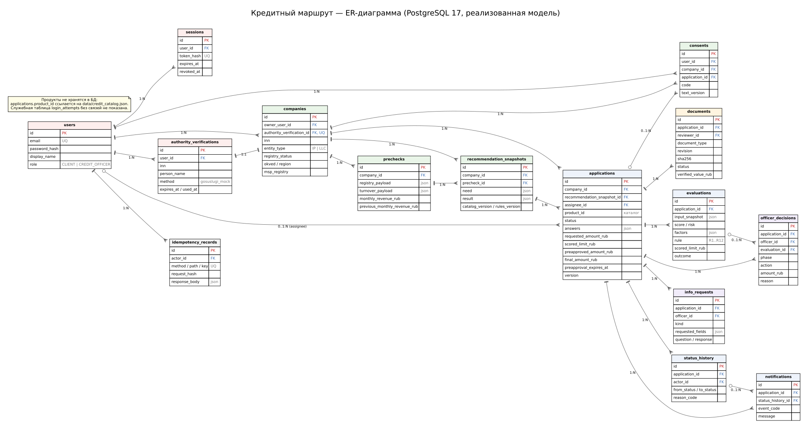

# Модель данных

Данные хранятся в PostgreSQL 17. Схему создают миграции Alembic (`backend/migrations/versions`); API при старте таблиц не создаёт. Модели SQLAlchemy лежат в `backend/app/models.py`, `backend/app/applications/models.py`, `backend/app/recommendations/models.py` и `backend/app/documents/models.py`.

Продукты в базе не хранятся: `applications.product_id` ссылается на продукт из `data/credit_catalog.json`, а снимки подбора и заявки записывают версии каталога и правил. Служебная таблица `login_attempts` на схеме не показана: у неё нет связей.

## Соглашения

- **Идентификаторы** — UUID4 строкой из 36 символов. Исключение — учётные записи и компании из начальных данных: у них постоянные UUID из `data/demo-companies.json`.
- **Деньги** — целые рубли в `BigInteger` (`*_rub`). Ставки — целые базисные пункты (`annual_rate_bps` = 2350 означает 23,50 %), LTV — `collateral_ltv_bps`. Двоичных чисел с плавающей точкой в расчётах нет: целочисленная арифметика, для аннуитета — `Decimal`.
- **Время** — `DateTime(timezone=True)`, в UTC; API отдаёт ISO 8601 с `Z`. Возраст бизнеса считается по деловой дате (`business_reference_date`). Сессии и сроки идут по реальным часам.
- **Неизвестное значение** — `null`, а не ноль: нет оборота — нет лимита.
- **Ревизии.** `applications.version` и `companies.version` начинаются с 1 и растут на 1 за каждую успешную команду. Колонки `sequence` упорядочивают оценки, историю и решения одной заявки.
- **Неизменяемость.** Снимки подбора, оценки, строки истории и согласия только добавляются. `submitted_input_snapshot` записывается один раз при отправке.

## Сущности

| Таблица | Назначение | Ключевые поля | Связи |
|---|---|---|---|
| `users` | Учётные записи | `email` (уникальна), `password_hash` (Argon2id), `display_name`, `role` ∈ `CLIENT`, `CREDIT_OFFICER` | — |
| `sessions` | Серверные сессии | `token_hash` (SHA-256 токена из cookie, уникален), `expires_at` (+12 ч), `revoked_at?` | `user_id` → users |
| `login_attempts` | Неудачные входы для ограничения частоты | `bucket` (хеш почты и адреса), `attempted_at` | — |
| `authority_verifications` | Подтверждения полномочий через Госуслуги (заглушка) | `inn`, `person_name`, `role`, `method` ∈ `gosuslugi_mock`, `seed`, `verified_at`, `expires_at` (+30 мин), `used_at?` | `user_id` → users |
| `companies` | Компании клиента | `inn`, `entity_type` ∈ `IP`, `LLC`, `name?`, `registered_at?`, `registry_status` (`active`, `inactive`, `unknown`), `okved?`, `region?`, `msp_registry?`, `legal_address?`, `fixture_id?`, `business_reference_date?`, `version` | `owner_user_id` → users; `authority_verification_id?` → authority_verifications (1:1) |
| `prechecks` | Проверки источников: каждая проверка — новая строка | `registry_source_status`, `turnover_source_status` (`available`, `missing`, `unavailable`), `registry_payload`, `turnover_payload` (JSON), `monthly_revenue_rub?`, `previous_monthly_revenue_rub?`, `financial_period_end?`, `source_version`, `checked_at`, `synthetic` | `company_id` → companies |
| `consents` | Согласия: только добавляются | `code` ∈ ONBOARDING_PROCESSING, REGISTRY_LOOKUP, APPLICATION_PROCESSING, BKI; `text_version` (`consent-v2`); `granted_at` | `user_id` → users; `company_id` → companies; `application_id?` → applications (у согласий при отправке) |
| `recommendation_snapshots` | Неизменяемые снимки подбора | `need` (`{requested_amount_rub}`), `input_snapshot` (компания и проверка), `result` (все карточки), `catalog_version`, `rules_version` | `company_id` → companies; `precheck_id` → prechecks |
| `applications` | Заявки | `product_id`, `status` (12 значений), `answers` (JSON анкеты), `current_stage` 1–6, `version`, `submitted_at?`, `requested_amount_rub?`, `indicative_limit_rub?`, `scored_limit_rub?`, `preapproved_amount_rub?`, `final_amount_rub?`, `preapproved_at?`, `preapproval_expires_at?`, `catalog_version`, `rules_version`, `submitted_input_snapshot?` | `company_id` → companies; `recommendation_snapshot_id` → recommendation_snapshots; `assignee_id?` → users |
| `evaluations` | Результаты проверок (по одному на отправку, повтор или ответ клиента) | `score?`, `risk?` (`low`, `medium`, `high`), `factors?`, `rule` (`R1`…`R12`), `scored_limit_rub?`, `outcome`, `reasons`, `input_snapshot`, `sources` (проверка и ответ БКИ) | `application_id` → applications |
| `info_requests` | Запросы сведений | `kind` ∈ `client_answers`, `trusted_source`; `source?` ∈ `registry`, `turnover`, `bki`; `requested_fields`, `question`, `response?`, `responded_at?`, `resolved_at?` | `application_id` → applications; `officer_id?` → users (у системного запроса пусто) |
| `status_history` | История переходов | `from_status?`, `to_status`, `reason_code`, `reason_text`, `application_version` | `application_id` → applications; `actor_id?` → users (у системного шага пусто) |
| `notifications` | Уведомления в кабинете (наружу не отправляются) | `event_code`, `channel` = `demo_in_app`, `message` | `application_id` → applications; `status_history_id?` → status_history |
| `officer_decisions` | Решения специалиста | `phase` ∈ `preliminary`, `final`; `action` ∈ `preapprove`, `approve`, `reject`, `request_info`; `amount_rub?`, `reason` | `application_id` → applications; `officer_id` → users; `evaluation_id?` → evaluations |
| `documents` | Версии загруженных файлов | `document_type` (4 типа), `revision`, `original_name`, `media_type`, `size_bytes`, `sha256` (хеш реальных байтов), `storage_key` (случайное имя файла, наружу не отдаётся), `status` ∈ UPLOADED, ACCEPTED, REJECTED, SUPERSEDED, DELETED; `review_reason?`, `verified_value_rub?`, `reviewed_at?` | `application_id` → applications; `reviewer_id?` → users |
| `idempotency_records` | Сохранённые ответы команд для повторов | `method`, `path`, `key`, `request_hash` (SHA-256 тела), `response_status`, `response_body`, `resource_id?` | `actor_id` → users |

`submitted_input_snapshot` фиксирует при отправке всё, по чему заявка решается дальше:

- время отправки и снимок подбора;
- версии каталога и правил;
- продукт целиком, с действующими условиями;
- `secured` — заявка с залогом: продукт требует залог или залог заявлен по продукту, где он необязателен;
- `required_documents`;
- компанию, проверку источников, ответы анкеты и согласия.

Повторная проверка, ответ на запрос, перечень документов и границы решений специалиста читают эти данные, а не текущий каталог.

## Ограничения целостности

| Ограничение | Таблица | Что гарантирует |
|---|---|---|
| `uq_active_application_company_product` — частичный уникальный индекс по (`company_id`, `product_id`) для статусов CHECKING, WAIT_EXTERNAL, MANUAL_REVIEW, NEED_INFO, PREAPPROVED, DOCS_UPLOADED, DOCS_REWORK | applications | Одна активная отправленная заявка компании на продукт |
| `uq_officer_decision_once` — частичный уникальный индекс по (`application_id`, `action`) для `preapprove`, `approve`, `reject` | officer_decisions | Каждое такое решение — не больше одного раза на заявку; запросы сведений могут повторяться |
| `uq_current_document` — частичный уникальный индекс по (`application_id`, `document_type`) для UPLOADED, ACCEPTED, REJECTED | documents | Один текущий файл на каждый обязательный документ |
| `company_owner_inn` (`owner_user_id`, `inn`) | companies | Один ИНН у одного владельца не повторяется; разные клиенты могут добавить один ИНН |
| `company_authority_verification` (`authority_verification_id`) | companies | Подтверждение через Госуслуги добавляет только одну компанию |
| `idempotency_scope` (`actor_id`, `method`, `path`, `key`) | idempotency_records | Ключ повтора уникален для пользователя и команды |
| `precheck_company_revision`, `evaluation_application_sequence`, `status_history_application_sequence`, `officer_decision_application_sequence`, `document_revision` | разные | Однозначный порядок строк одной компании или заявки |
| `valid_application_status`, `valid_application_stage` | applications | Только 12 статусов; этап 1–6 |
| `valid_evaluation_rule`, `valid_evaluation_outcome`, `valid_evaluation_risk` | evaluations | Правило R1–R12, статус из списка, риск `low`, `medium`, `high` или пусто |
| `info_request_kind_rules` | info_requests | Запрос к источнику: есть `source`, нет специалиста. Запрос ответов: без `source` |
| `decision_action_phase`, `decision_amount` | officer_decisions | `preapprove` и `request_info` — предварительные, `approve` — окончательное; сумма есть только у одобрений и больше нуля |
| `valid_document_type`, `valid_document_status`, `valid_document_media_type`, `valid_document_size` (1 байт – 20 МиБ), `valid_document_revision_hash` | documents | Допустимые значения и размер; ревизия ≥ 1, хеш из 64 символов |
| `document_review_recorded`, `document_unreviewed` | documents | Поля проверки заполнены ровно у принятых и отклонённых версий |
| `document_verified_value` | documents | Положительная проверенная стоимость есть только у принятого отчёта об оценке залога |
| `valid_user_role`, `valid_verification_method`, `demo_notification_channel` | users, authority_verifications, notifications | Значения из списка |

Гонки разрешает база. Команды блокируют сначала строку компании, затем строку заявки. Частичные индексы отсекают дубликаты, которые блокировка могла бы пропустить. Тесты на PostgreSQL проверяют это одновременными запросами.

## Миграции

Порядок применения — `backend/.venv/bin/alembic -c backend/alembic.ini upgrade head`:

| Ревизия | Что добавляет |
|---|---|
| `477de883cdb2` | Пользователи, сессии, неудачные входы, компании, проверки источников, согласия, записи идемпотентности |
| `070eeaa75839` | Порядок проверок по ревизии компании (`company_version`) |
| `6ca90a120ab3` | Снимки подбора |
| `f5f74d672e3b` | Заявки, оценки, запросы сведений, история, уведомления; внешний ключ `consents.application_id` и индекс одной активной заявки |
| `abcc1f065f7f` | Решения специалиста |
| `ee4e652349c6` | Документы |
| `b3c1d2e4f5a6` | Признак реестра МСП у компании (`companies.msp_registry`) |
| `c4d5e6f7a8b9` (head) | Подтверждения через Госуслуги и ссылка компании на своё подтверждение |

## Синтетические данные

| Файл | Содержание |
|---|---|
| `data/demo-companies.json` | Версия `demo-fixtures-v2`. Три учётные записи (`client@demo.local`, `other@demo.local`, `officer@demo.local`) и 10 синтетических компаний: ИНН с верной контрольной суммой, реестр и обороты, признак МСП, налоговый режим, число сотрудников, ФИО директора для заглушки Госуслуг, ответы БКИ, сценарии восстановления источников и ожидаемые итоги проверки. Деловая дата — 2026-10-24 |
| `data/credit_catalog.json` | Каталог продуктов (схема 3.2, `2026-10-25.1`): 11 продуктов-карточек и бейдж |
| `data/demo-policy.json` | Правила решения (`rules-v2`) |
| `data/catalog.research.json` | Архив прежнего исследования из 9 записей с `can_apply=false`. Приложение его не читает |

Ожидаемые итоги в фикстурах — метки для сверки в тестах; приложение их не использует. Заглушки берут из фикстуры только свои поля: реестр, обороты, ответ БКИ, ФИО директора для Госуслуг. Начальные данные загружает `python -m app.seed`. Загрузка повторяема и выполняется только при `DEMO_MODE=true`. Что показывает каждая компания — в [запуске и показе](demo.md#синтетические-компании).
