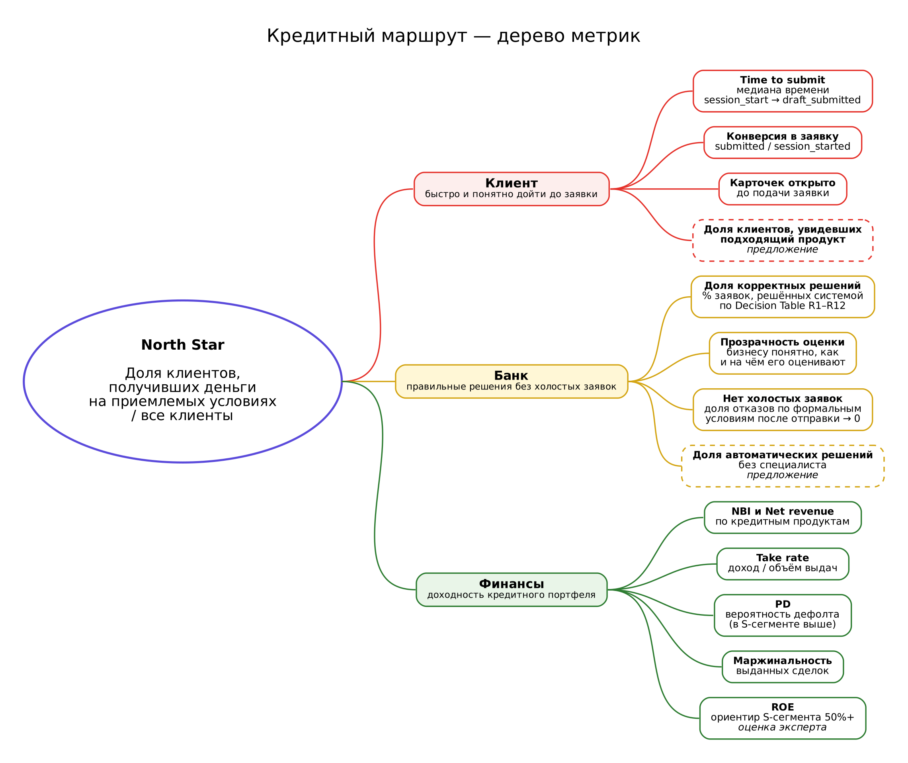

# Продуктовое исследование: CustDev и JTBD

Здесь собрано, какую задачу клиента решает «Кредитный маршрут», откуда взялись требования к продукту и как мы будем понимать, что решение работает.

## Содержание

1. [Контекст рынка](#контекст-рынка)
2. [Методика](#методика)
3. [Портрет клиента](#портрет-клиента)
4. [JTBD](#jtbd)
5. [Боли клиента и ограничения банка](#боли-клиента-и-ограничения-банка)
6. [Выводы → решения в продукте](#выводы--решения-в-продукте)
7. [Дерево метрик](#дерево-метрик)
8. [Гипотезы для проверки](#гипотезы-для-проверки)
9. [Ограничения исследования и следующие шаги](#ограничения-исследования-и-следующие-шаги)

## Контекст рынка

Малый и микробизнес в 2026 году работает в сжимающемся рынке. Покупательная способность клиентов падает, и небольшим компаниям это даётся тяжелее всего.

- **Закрытий больше, чем открытий.** По оценке ЦМИ Сбербанка на данных ФНС и Росстата, в январе–мае 2026 года прекращений деятельности по экономическим причинам впервые за время наблюдений стало больше, чем регистраций новых компаний. Регистраций — 62 тыс. против 80 тыс. годом ранее. В мае на 1000 действующих организаций пришлось 5,5 прекращения и 4,3 регистрации. Разрыв объясняется прежде всего падением регистраций: общее число закрытий за полугодие, по данным «ФинЭкспертизы», даже снизилось ([Inc. Russia](https://incrussia.ru/news/v-rossii-vpervye-zafiksirovali-demograficheskij-spad-biznesa/)).
- **Налоговая нагрузка выросла.** За первое полугодие 2026 года по упрощённой схеме закрылись 47,5 тыс. компаний МСП, втрое больше, чем годом ранее. Авторы подсчёта связывают это с ростом НДС до 22% и снижением порога освобождения от НДС с 60 до 20 млн ₽ ([Новая газета Европа](https://novayagazeta.eu/articles/2026/08/03/malyi-i-srednii-biznes-stal-v-tri-raza-chashche-zakryvatsia-po-uproshchennoi-skheme-skoree-vsego-eto-reaktsiia-na-rost-nalogov-news), подсчёт проекта.
- **Нестабильная выручка.** По оценке эксперта, больше половины компаний отмечают нестабильные результаты и работают на грани минимальной выручки. Открытого источника для этой цифры мы пока не нашли, поэтому приводим её как экспертную оценку.

**Что это значит для продукта:** кредит для такого клиента - это осторожное решение. Ему важно заранее понять, сколько и на каких условиях он получит, и не тратить время на заявку, которая закончится отказом.

## Методика

| Источник | Что дал | Ограничения |
|---|---|---|
| Публичные отзывы клиентов банков (Банки.ру, Модульбанк) | четыре сценария ИП: хостел (№1), клиенты Т-Банка (№2), Совкомбанка (№3), Газпромбанка (№4) | отзывы пишут в основном недовольные клиенты; выборка не репрезентативна |
| Экспертное интервью (Владимир,Бизнес-аналитик в Т-банк) | джобы бизнеса, ограничения банка при кредитовании МСБ, бизнес-метрики и ценообразование | взгляд со стороны банка, одно интервью |
| Открытая статистика | контекст рынка 2026 | данные агрегированные, по юрлицам |
| Командная доска (Яндекс Доски) | дерево метрик | — |

## Портрет клиента

Владелец ИП или небольшого ООО в России, 2026 год:
- выручка нестабильна и близка к минимальной, клиенты тратят меньше;
- считает каждый рубль: режет расходы на операционку и персонал;
- кредит под 30% годовых ему не нужен, он ищет льготные варианты: субсидии, программы ФРП, лизинг;
- следит за налогами и переходит с УСН на АУСН, чтобы платить разумную сумму;
- отчётность у него скудная, часто бизнес молодой.

## JTBD

### Большие работы бизнеса (экспертное интервью)

| # | Работа | Что это значит для кредитного кабинета |
|---|---|---|
| A | Урезать расходы на операционку и персонал | кредит должен окупаться; дорогие и длинные процедуры отталкивают |
| B | Найти оборотные средства в обход дорогих кредитов: интереснее ФРП, лизинг, субсидии | на первом месте льготные программы и альтернативы кредиту |
| C | Снизить налоговую нагрузку, например перейти с УСН на АУСН | налоговый режим влияет на то, какие данные о бизнесе банк видит |

### Работы в момент кредитования (CustDev по отзывам)

| # | Когда… | хочу… | чтобы… |
|---|---|---|---|
| 1 | накоплений на вторую точку не хватает | заранее узнать реальную сумму и от чего она зависит | не тратить недели на документы ради предложения, которое не решает задачу |
| 2 | оборотные деньги нужны быстро | видеть, какое решение банка уже принято и когда придут деньги | планировать закупки |
| 3 | надо оплатить поставщику | заранее знать лимит и условия получения денег | не терять на комиссиях и ограничениях |
| 4 | выбираю банк | сразу знать, доступен ли мне продукт как ИП | не тратить время на заявку впустую |

## Боли клиента и ограничения банка

### Боли клиента (CustDev)

| Боль | Сценарий |
|---|---|
| Сумма в предложении меньше запрошенной, и никто не объясняет почему | №1, №3 |
| Документы собирают вслепую, часть приходится переделывать | №1 |
| Пишут «одобрено», хотя решения ещё нет | №2 |
| Разные сотрудники и каналы говорят разное | №2, №4 |
| Деньги пришли на карту, вывести их без комиссии трудно | №3 |
| О недоступности продукта узнают в самом конце | №4 |
| Одни и те же данные приходится вводить и объяснять несколько раз | №1, №2, №4 |

### Ограничения банка (экспертное интервью)

- **Длинные кредиты МСБ почти не выдаются.**
- **Отчётности не хватает.** Банк опирается на карточку 51 счёта, то есть движение по расчётному счёту. С залогом вероятность одобрения выше. Лизинг продают с высоким авансом, от 30%. Для факторинга нужен надёжный дебитор.
- **Много заявок от молодых компаний.** Им можно предлагать небольшие суммы, до 5 млн ₽, под высокий процент.
- **Преимущество — закрыть потребность почти по каждой входящей заявке.** Вместо отказа подобрать вариант, который подходит.

## Выводы → решения в продукте

| Вывод | Решение в «Кредитном маршруте» | Статус |
|---|---|---|
| Клиент избегает дорогих кредитов и ищет льготы (B) | в каталоге три программы ПСК (от КС−3,5%), кредит с господдержкой и бейдж «зонтичного» поручительства Корпорации МСП | ✅ |
| Лизинг и программы ФРП интереснее кредита (B) | в каталоге их нет | ❌ пробел |
| Нужно знать сумму заранее (№1) | личная оценка на карточке, отдельно от максимума продукта; при превышении — «Рассчитать на N ₽» | ✅ |
| Отказ без объяснения (№1, №3) | у отказа есть правило и текст причины; меньшая сумма (R9) объясняется | ✅ |
| Нужен понятный статус (№2) | единый статус для клиента и специалиста, журнал переходов, следующий шаг на экране | ✅ |
| Условия получения денег (№3) | ставка и ориентировочный платёж на карточке; комиссии в каталоге не раскрыты | 🟡 частично |
| Доступен ли продукт мне (№4) | условия продукта проверяются по данным компании до анкеты; неподходящий продукт нельзя начать | ✅ |
| Повторный ввод данных | данные из реестра и Госуслуг подставляются и не редактируются | ✅ |
| Скудная отчётность, карточка 51 счёта | обороты берутся из источника, выписка входит в комплект документов | 🟡 на заглушках |
| С залогом вероятность выше | продукты с залогом, лимит растёт с учётом залога (LTV 70%) | ✅ |
| Факторинг требует хорошего дебитора | факторинг есть в каталоге; модели дебиторской задолженности нет, лимит считается от оборота | 🟡 частично |
| Много молодых компаний | срок работы бизнеса — фактор скоринга; отдельного продукта «мини-суммы для молодых» нет | 🟡 частично |
| Закрыть потребность почти каждой заявки | показываем все 11 продуктов со статусом соответствия, предлагаем меньшую сумму вместо отказа, средний риск уходит к специалисту | ✅ |
| Холостые заявки | заявку нельзя отправить, пока не выполнены условия продукта | ✅ |
| Переход на АУСН (C) | налоговый режим берётся из реестра, но отдельного значения для АУСН нет (только ОСН, УСН, ПСН, «другое») | 🟡 добавить АУСН |
| Урезать расходы (A) | вне рамок кредитного кабинета | — |

## Дерево метрик

### North Star

**Доля клиентов, получивших деньги на приемлемых условиях, от всех клиентов.**

Прежде чем считать, нужно договориться о двух определениях:
- **«Все клиенты»** — клиенты, начавшие подбор (`session_start`) за период.
- **«Приемлемые условия»** — пока открытый вопрос. Например: деньги выданы, сумма не меньше X% запрошенной, а клиент принял предложение, а не отказался от него.

### Ветка клиента

| Метрика | Как считать | Цель |
|---|---|---|
| Time to submit | медиана времени от `session_start` до `draft_submitted` | ↓ |
| Конверсия в заявку | `submitted / session_started` | ↑ |
| Сколько карточек продуктов клиент открыл до подачи заявки | среднее и медиана на клиента | слишком много — подбор не помогает |
| *(свободный слот)* | предложение: доля клиентов, увидевших хотя бы один подходящий продукт | ↑ |

### Ветка банка

| Метрика | Как считать | Цель |
|---|---|---|
| Доля корректных решений | % заявок, по которым система приняла решение по таблице правил (Decision Table, R1–R12) | ↑ |
| Прозрачность оценки | бизнесу важно знать, как и по чему его оценивают; измерять через долю решений с показанной причиной и опрос | ↑ |
| Нет холостых заявок | доля заявок, отклонённых по формальным условиям после отправки | → 0 |

### Финансовые метрики (экспертное интервью)

- **NBI** (чистый банковский доход) и **Net revenue** по всем кредитным продуктам.
- **Take rate** — доход ÷ объём выдач.
- **PD** (вероятность дефолта). В S-сегменте она заметно выше, поэтому такие кредиты нужно продавать дороже.
- **Средняя маржинальность** выданных сделок.
- **ROE** — по оценке эксперта, в Т-Банке для S-сегмента сейчас ориентир 50%+.

### Гипотеза ценообразования

Быстрое решение без визита в отделение — отдельная ценность для клиента, поэтому такой процесс должен стоить дороже. Базовые ставки можно ставить от КС+8, смело — от КС+6.

Сверка с каталогом при ключевой ставке 14%: собственные продукты Альфа-Банка уже стоят от КС+7,5 (кредит с залогом, 21,5%) до КС+10 (кредит с господдержкой, 24%). Это ниже 30%, от которых клиент уходит (джоба B). Госпрограммы ПСК субсидируются, стоят ниже ключевой ставки, и под это правило не подпадают. В приложении гипотеза не реализована: ставки берутся из каталога как есть.

### Что можно посчитать уже сейчас

- время от создания черновика до отправки — по журналу статусов;
- доля автоматических решений и решений специалиста — по правилу, сохранённому в каждой оценке (R1–R12);
- доля «холостых» заявок — по отказам R1 при отправке.

Для остальных метрик нужен сбор событий на фронтенде. Финансовые метрики требуют реальных выдач, на демо-данных их не посчитать.

## Гипотезы для проверки

| # | Гипотеза | Как проверить |
|---|---|---|
| H1 | Если показать оценку суммы до заявки, доля отказов клиента от предложения снизится | сравнить доли принятых предложений с оценкой и без неё |
| H2 | Проверка условий продукта до анкеты сокращает холостые заявки | доля отказов R1 после отправки, до и после |
| H3 | Понятный статус и следующий шаг снижают число обращений «что с заявкой» | обращения в поддержку на одну заявку |
| H4 | Клиент готов платить больше за быстрое решение без визита | тест цены: КС+6 и КС+8 на сопоставимых сегментах |
| H5 | Малые суммы для молодых компаний под повышенную ставку закрывают их спрос без роста просрочки | PD и просрочка в когорте молодых компаний |
| H6 | Льготные программы и альтернативы кредиту (лизинг) повышают конверсию в выдачу | конверсия в выдачу по типам продуктов |

## Источники

- [Inc. Russia, 05.08.2026: впервые зафиксирован демографический спад бизнеса](https://incrussia.ru/news/v-rossii-vpervye-zafiksirovali-demograficheskij-spad-biznesa/) — аналитика ЦМИ Сбербанка по данным ФНС и Росстата.
- [Новая газета Европа, 03.08.2026: МСП в три раза чаще закрывается по упрощённой схеме](https://novayagazeta.eu/articles/2026/08/03/malyi-i-srednii-biznes-stal-v-tri-raza-chashche-zakryvatsia-po-uproshchennoi-skheme-skoree-vsego-eto-reaktsiia-na-rost-nalogov-news) — подсчёт проекта «Если быть точным» по данным ФНС.
- Каталог продуктов: `data/credit_catalog.json` (условия с публичных страниц Альфа-Банка и Корпорации МСП, ключевая ставка 14% с 23.10.2026).
- Экспертное интервью и командная доска (Яндекс Доски), октябрь 2026.
